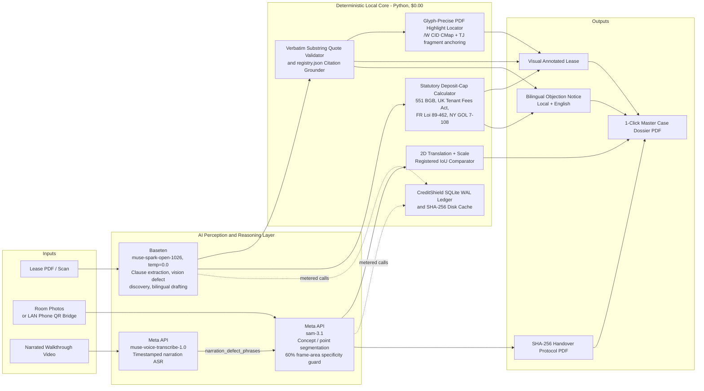

# 🛡️ LeaseLens

**Decode Every Clause. Prove Every Pixel. Protect Your Deposit.**

*Zero-Hallucination Legal Auditor & Multimodal SAM 3.1 Deposit Shield for International Tenants (`DE` · `UK` · `US_NY` · `FR` · `JP`)*


Built for the **Meta Global AI Developer Hackathon** — [github.com/shamas92/leaselens](https://github.com/shamas92/leaselens)

---

## The Problem & Our Core Rule

- International students and expats lose thousands to unlawful lease clauses and pre-existing room damage because they sign contracts in foreign legal systems.
- Standard LLM wrappers hallucinate statutes and miscalculate rent caps.
- **Our Core Rule — Meta AI Proposes, Deterministic Python Disposes:** Every AI-flagged clause is verified character-for-character against the raw lease text and statutory registry before display, all deposit math is computed in deterministic Python, and move-out damage is proven via translation-and-scale registered pixel IoU.

---

## Architecture — Split Providers, Deterministic Core



---

## How It Works — The 3-Step Workflow

| Step | What You Do | What LeaseLens Executes Under the Hood | Verified Proof |
|---|---|---|---|
| **1. Check Contract** (`/contract`) | Drop a lease PDF/photo or click `DE Dorm Contract` | Python computes exact statutory deposit caps, verifies quotes verbatim, maps glyph-precise highlight boxes onto the rendered page, and drafts a concise German + English objection letter | **Catches `€414.59` illegal deposit excess (`€950` vs `€535.41` cap on `€178.47` cold rent)** |
| **2. Photograph Damage** (`/evidence`) | Snap via the zero-dependency Reed–Solomon QR Phone Bridge, pick a curated dorm photo, or run a narrated walkthrough video | Muse Voice 1.0 transcripts steer SAM 3.1 per keyframe to lock full-color defect overlays into browser storage and a `SHA-256` Handover PDF | **Isolates open wall socket hazards & desk surface burns with zero binary-mask clutter** |
| **3. Compare Move-Out** (`/move-out`) | Compare a saved Day-1 reference against a new Move-Out photo | Normalizes cross-size rasters and runs a bounded 2D translation + scale search with an interactive 2.2× zoomed Before/After Curtain Wipe | **Compensates camera shift/zoom (`0.0%` raw → `85.3%+` registered IoU) or proves exact damage growth** |
| **Master Export** (Command Bar) | Click `Export Master Dossier PDF ($0.00)` | Compiles the annotated lease page, deposit math table, bilingual letters, and full-color SAM 3.1 masks into one courtroom-ready PDF | **Sealed with a master `SHA-256` fingerprint** |

---

## Curated Demo Resources — 1-Click Testing in Under 60 Seconds

Pre-seeded real-world dorm assets (`backend/demo-assets/` → `backend/storage/samples/`):

| Where | Resource | What It Proves |
|---|---|---|
| Preset Bar | `DE Dorm Contract` / `UK London AST` / `FR Paris Bail` | 1-page German student dorm lease (`Studentenwerk Musterstadt`) with 5 planted unlawful clauses: `§ 3 Kaution €950`, `§ 7a Kleinreparaturen €175`, `§ 12(5) €250 cleaning fee`, `§ 13 rigid paint schedule`, `§ 9a guest ban` |
| Step 2 Photos | `⚡ Open Wall Socket` (`dorm_open_socket.jpg`) | Fixture-hazard auto-discovery — SAM 3.1 isolates the uncovered socket |
| Step 2 Photos | `🔥 Table Surface Burn` (`dorm_table_burn.jpg`) | Clean surface-burn segmentation, ready to save as a Day-1 reference |
| Step 2 Walkthrough | `🎙️ Narrated Dorm Walkthrough` (`sample_walkthrough.mp4`) | Muse Voice 1.0 narration steering SAM 3.1 across keyframes |
| Step 2 Walkthrough | `🔇 Silent Dorm Walkthrough` | Vision-only defect discovery with no narration |
| Step 3 Move-Out | `🔥 Table Burn — Grown (Damage Growth Demo)` | Registered IoU `86.1%` after compensating a 2.35× reframing (Δx `+2`, Δy `−82`); residual area change `+8.4%` — inside the ±10% band, so the UI reads the burn as essentially unchanged |

---

## Quick Start & Verification

**1. Seed demo assets & start the backend (`:8000`):**

```bash
python backend/seed_demo_cache.py
cd backend && python -m uvicorn main:app --port 8000
```

Windows PowerShell equivalent:

```powershell
python backend\seed_demo_cache.py
cd backend; python -m uvicorn main:app --port 8000
```

**2. Start the frontend (`:3000`):**

```bash
cd frontend && npm install && npm run build && npm start
```

**3. Configuration:** copy `backend/.env.example` to `backend/.env` and add your own Meta API and Baseten keys. The seeded demos above run without live keys; live decoding and segmentation use yours.

**4. Run the test suites:**

```bash
cd backend && python -m unittest discover -s tests
# 132 tests — OK (skipped=1)

cd frontend && node --test src/lib/*.test.ts
# 65 tests — pass

npx tsc --noEmit
# 0 errors
```

---

*LeaseLens produces verified evidence and preliminary contract analysis. It is not a law firm and its output is not legal advice.*
